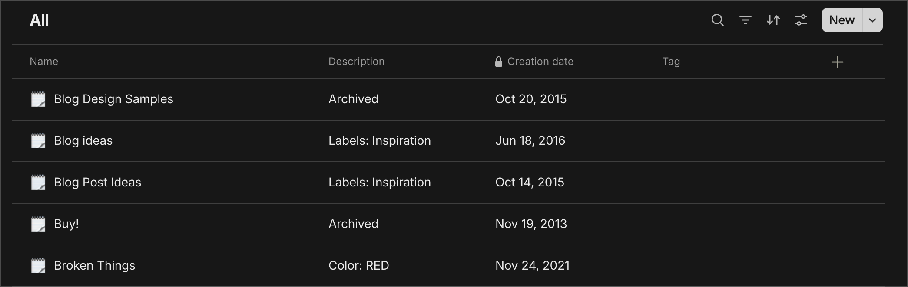

# keep2Anytype

A command-line tool that converts a Google Keep export into Any-Block files you can bulk import into [Anytype](https://anytype.io).

## Setup

You need Node.js 22 or newer. With [nvm](https://github.com/nvm-sh/nvm), `nvm use` picks up the version in `.nvmrc`.

```sh
git clone https://github.com/moverware/keep2Anytype.git
cd keep2Anytype
npm install
```

Export your Keep data from [Google Takeout](https://takeout.google.com/settings/takeout) and unzip it.

To tag every converted note, create a tag in Anytype, copy `.env.sample` to `.env` and set `TAG_ID` to the tag's id. You can find the id by exporting an Anytype object that has the tag as `Any-Block` and reading the `tag` field in the exported JSON.

## Usage

```sh
npm run cli -- -p <path-to-takeout>/Takeout/Keep -o <output-folder>
```

The `--` passes the flags through npm to the tool.

| Flag               | Default | Effect                                                                                                                                                                                                      |
| ------------------ | ------- | ----------------------------------------------------------------------------------------------------------------------------------------------------------------------------------------------------------- |
| `-p`, `--path`     |         | Google Keep export folder (required)                                                                                                                                                                        |
| `-o`, `--output`   |         | Folder to write the Any-Block files to. Created if missing; must differ from `--path` (required)                                                                                                            |
| `-m`, `--mode`     | `mixed` | `mixed` turns titled notes into Anytype pages and untitled notes into Anytype notes. `pages` turns every note into a page, titling untitled notes with their created date                                   |
| `-a`, `--archive`  | off     | Include archived notes                                                                                                                                                                                      |
| `-t`, `--trashed`  | off     | Include trashed notes                                                                                                                                                                                       |
| `-e`, `--emoji`    | none    | Icon emoji for every converted object                                                                                                                                                                       |
| `-d`, `--metadata` | off     | Write Keep metadata to the object's description: the note colour (unless default), whether it was pinned, archived or trashed, and its labels. For example `Color: YELLOW \| Pinned \| Labels: work, ideas` |
| `-r`, `--relation` | off     | Also show the description in the body of the object. Only has an effect with `--metadata`                                                                                                                   |

In Anytype, choose **File > Import > Any-Block** and select the output folder.

Try the import in an empty space first to check the result before importing into your main space.

Anytype copies images and other attachments from your Takeout folder during the import, so import on the same computer and leave the Takeout folder where it was when you ran the conversion.

## Example

```sh
npm run cli -- -p ~/Downloads/Takeout/Keep -o ~/Downloads/anytype-import -a -t -d -r -m pages -e 🗒️
```

This converts every note, including archived and trashed ones, into pages with a notepad icon. Each page keeps its Keep created date and shows its labels and colour in the description.



## What gets converted

- Text, checklists (with their checked state), and links. URLs in text become links.
- Images, audio recordings and other attachments, placed above the note text as they are in Keep.
- Created and last-edited dates.
- Colour, pinned/archived/trashed state and labels, as description text with `--metadata`. Labels don't become Anytype tags.

## Contributing

See [CONTRIBUTING.md](CONTRIBUTING.md).
